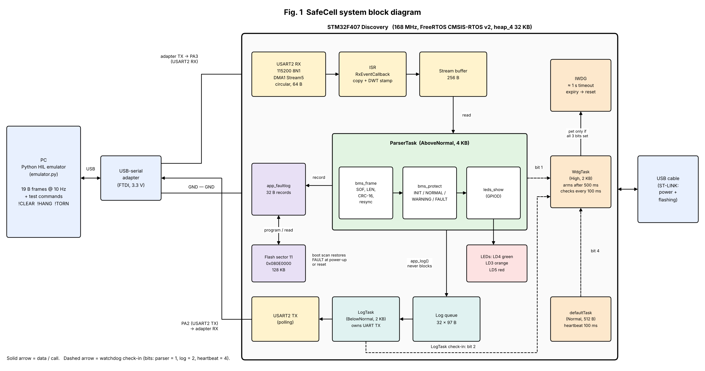

# SafeCell: fault-tolerant battery-monitoring firmware (STM32F407 + HIL)

Battery-pack monitoring node on an STM32F407 Discovery board (FreeRTOS, CMSIS-RTOS v2). It receives pack
data frames over UART, decides NORMAL / WARNING / FAULT, drives three LEDs, and keeps a latched FAULT
across resets in a flash fault log. A Python emulator on the PC acts as the battery pack and checks the
board's replies (hardware-in-the-loop, HIL).

Course: ES ZG518 Software for Embedded Systems, situational learning assignment.

## Problem
The first version raised a false FAULT on a single noisy frame and flipped state repeatedly when a value
hovered at a threshold. It was reproduced, analysed and fixed (3-frame debounce, hysteresis, watchdog,
persistent fault log).

## Layout
| Path | Content |
|---|---|
| `firmware/bms_node` | STM32CubeIDE project (`Core/Src`, `Core/Inc`) |
| `firmware/tests` | host-side unit tests (gcc, no board needed) |
| `hil/emulator.py` | PC emulator and pass/fail checker |
| `docs/requirements.md` | requirements and thresholds |
| `docs/evidence` | logs and CSV results quoted in the report |
| `docs/diagrams` | block, use case, sequence, timing, state and flow diagrams (PNG) |

## Frame format
SOF 0xA5, LEN 14, SEQ, 4 cell voltages (uint16 mV), current (int16 mA), 2 temperatures (int16, 0.1 C),
CRC-16/MODBUS. 19 bytes at 10 Hz, 115200 8N1.

## Run the host tests
    gcc -std=c99 -Wall -Wextra -I firmware\bms_node\Core\Inc firmware\tests\test_bms_frame.c firmware\bms_node\Core\Src\bms_frame.c -o firmware\tests\test_bms_frame.exe
    gcc -std=c99 -Wall -Wextra -I firmware\bms_node\Core\Inc firmware\tests\test_bms_protect.c firmware\bms_node\Core\Src\bms_protect.c firmware\bms_node\Core\Src\bms_frame.c -o firmware\tests\test_bms_protect.exe
    gcc -std=c99 -Wall -Wextra -I firmware\bms_node\Core\Inc firmware\tests\test_bms_faultlog.c firmware\bms_node\Core\Src\bms_faultlog.c firmware\bms_node\Core\Src\bms_frame.c -o firmware\tests\test_bms_faultlog.exe

Each test prints PASS/FAIL lines and ends with `0 failure(s)`.

## Run the HIL (board on COM14)
Press RESET, then:

    python hil\emulator.py COM14 --scenario <normal|spike|hover|warning|overtemp|hang|persist> --check [--duration N] [--csv file]

`hang` needs `--duration 12`, `persist` needs `--duration 32`. Every scenario except `persist` first sends
`!CLEAR` to release a FAULT stored in flash.

## Design diagrams

| Figure | File |
|---|---|
| Fig. 1 System block diagram | [D01_block_diagram.png](docs/diagrams/D01_block_diagram.png) |
| Fig. 2 Use case diagram | [D02_use_case_diagram.png](docs/diagrams/D02_use_case_diagram.png) |
| Fig. 3 Sequence diagram, overtemp run | [D03_sequence_diagram.png](docs/diagrams/D03_sequence_diagram.png) |
| Fig. 4 Detection timing | [D04_timing_diagram.png](docs/diagrams/D04_timing_diagram.png) |
| Fig. 5 Protection state machine | [D05_state_machine.png](docs/diagrams/D05_state_machine.png) |
| Table 1 Tasks and interrupts | [D06a_task_table.png](docs/diagrams/D06a_task_table.png) |
| Fig. 6a ParserTask flowchart | [D06b_parser_flowchart.png](docs/diagrams/D06b_parser_flowchart.png) |
| Fig. 6b Flash boot scan flowchart | [D06c_boot_scan_flowchart.png](docs/diagrams/D06c_boot_scan_flowchart.png) |
| Fig. 6c WdgTask flowchart | [D06d_watchdog_flowchart.png](docs/diagrams/D06d_watchdog_flowchart.png) |

## Results (on target, see `docs/evidence/hil_results_final.csv`)
| Scenario | Result |
|---|---|
| normal, spike, hover | PASS, no state change |
| warning | PASS, 209 ms (limit 400 ms) |
| overtemp | PASS, 208 ms (limit 400 ms) |
| hang | PASS, back in NORMAL after 1209 ms (limit 3000 ms) |
| persist | PASS, FAULT survives watchdog reset and a torn clear |

The v1 baseline (`hil_results_v1.csv`) fails the spike and hover scenarios.

## Versions (git tags)
`v1-baseline` single-frame decisions, `v2-debounce` debounce and hysteresis, `v3-watchdog` supervisor and
IWDG, `v4-faultlog` flash fault log, `v5-final` report freeze.

## Limitations
- Debounce adds about 200 ms to the reaction time (still inside the 400 ms limit).
- Detection time is measured on the PC and includes about 20 ms of USB-serial adapter jitter.
- `!CLEAR` is unauthenticated.
- Test commands `!HANG` and `!TORN` exist only when `SAFECELL_FAULT_INJECT` is 1 (it is 1 in this build).
- A full flash log keeps the board latched; it needs a programmer erase of sector 11.
- Communication-loss fault and contactor output are not implemented.
- Hysteresis clear, log-full and flash-write-error cases are tested on the host only.